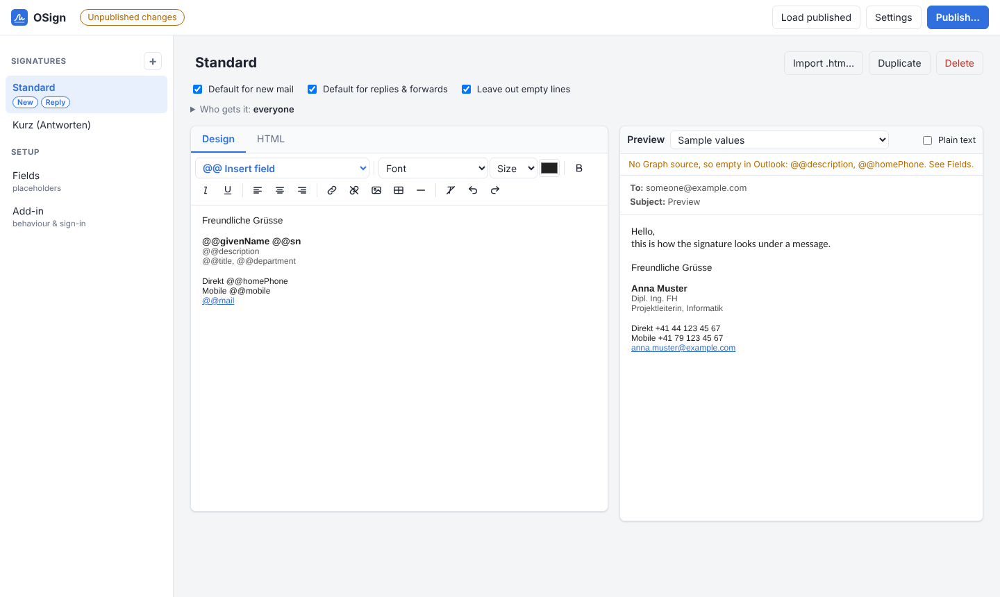

# OSign

Central email signatures for **classic and new Outlook**, managed in one place.

- **The editor** (`editor/OSign.ps1`): a PowerShell script, built like
  [NOBS SQL Editor](https://github.com/monsama/nobs-sql-editor-powershell). It starts a small web
  server on 127.0.0.1 and opens a web interface where you design the signatures, set who gets which
  one, and publish them.
- **The Outlook add-in** (`addin/`): it inserts the right signature by itself in every new message,
  reply and forward, and switches signatures when the From address changes. Its pane lets users pick
  another signature or choose their own defaults. It fills the placeholders (`@@givenName`,
  `@@mobile`, and so on) with each user's details from Microsoft Graph.



The add-in and the published signatures are served from GitHub Pages of this repository. Another
web server can take over later; see [Hosting elsewhere](#hosting-elsewhere).

```
 OSign.ps1 (editor)                 GitHub: monsama/osign            Outlook (every user)
 ┌───────────────────┐  publish    ┌──────────────────────┐ Pages  ┌──────────────────────────┐
 │ web UI on         │ ──────────> │ config/signatures.json│ ─────> │ OSign add-in             │
 │ 127.0.0.1         │  one commit │ config/assets/*.png   │ https  │  new mail / reply → sign │
 └───────────────────┘             └──────────────────────┘        │  user details ← Graph /me│
                                                                    └──────────────────────────┘
```

## Where it works

| Outlook | Automatic signature | Pane |
|---|---|---|
| New Outlook for Windows | yes | yes |
| Outlook on the web | yes | yes |
| Classic Outlook for Windows (Microsoft 365, current channel) | yes | yes |
| Outlook for Mac (new Outlook) | yes | yes |
| Outlook for iOS / Android | not yet | - |

All of these need Exchange Online (Microsoft 365) mailboxes.

## Fields

These are the placeholders the signatures used before, mapped to where the add-in reads each value.

| Field | Placeholder | AD attribute | Microsoft Graph |
|---|---|---|---|
| Vorname | `@@givenName` | givenName | `givenName` |
| Name | `@@sn` | sn | `surname` |
| Beschreibung 1 | `@@description` | description | *(none, see below)* |
| Beschreibung 2 | `@@department` | department | `department` |
| Beschreibung 3 | `@@title` | title | `jobTitle` |
| Handy | `@@mobile` | mobile | `mobilePhone` |
| Direkte Nr. ext. | `@@homePhone` | homePhone | *(none, see below)* |
| Abwesenheit | `@@info` | info | *(none, see below)* |
| Mail | `@@mail` | mail | `mail` |

Graph has no `description`, `homePhone` or `info`. To use them, sync them with Entra Connect,
either into `onPremisesExtensionAttributes.extensionAttribute1`…`15` or as directory extensions
(`extension_<appId>_description`). Then enter that path as the field's Graph source in the editor.
Until then those fields stay empty in Outlook. The editor's preview can still show them, because it
reads them from AD.

A line whose fields all come out empty is left out, so nobody's signature shows "Mobile:" with no
number. This works for paragraphs, lines split by line breaks, and table rows.

## Getting started

[docs/SETUP.md](docs/SETUP.md) has every step. In short:

1. **GitHub Pages**: in this repository, go to Settings → Pages → Source: **GitHub Actions**.
2. **Entra ID**: register an app (a single-page application with redirect URI
   `brk-multihub://monsama.github.io`, Graph `User.Read`, admin consent).
3. **Editor**: on Windows, run
   ```powershell
   powershell -ExecutionPolicy Bypass -File .\editor\OSign.ps1
   ```
   Then, in Settings, add a fine-grained GitHub token (this repository only, *Contents: Read and
   write*). Make the signatures, enter the app registration under *Add-in*, and click **Publish**.
4. **Microsoft 365 admin center**: go to Settings → Integrated apps → Upload custom apps and upload
   `https://monsama.github.io/osign/manifest.xml`. Then assign it to the users.

## How a signature is chosen

Each signature can be the default for new mail, for replies and forwards, or both. It can also be
limited to departments or to sender domains. For each message:

1. If the editor allows user choice and the user picked a signature (or *none*) in the pane, that
   one is used.
2. Otherwise the default for that kind of message is used. When several defaults apply, the one for
   fewer people wins: a default for one sender domain beats a default for everyone.

Outlook's own signature is switched off for messages the add-in signs (an option in the editor), so
a mail never gets two.

## Privacy

GitHub Pages is public. Only the templates and images are published there, never anyone's details.
Each user's values are read at the moment of writing, from their own Graph profile, with their own
sign-in. The add-in keeps a copy in that user's own mailbox settings, read again after 15 minutes
and used when Graph cannot be reached.

## Hosting elsewhere

The editor can also publish to a folder (Settings → *A folder*), for example the folder of an IIS
site or of any HTTPS web server. Build the add-in for that address:

```
npm ci
BASE_URL=https://intranet.example.com/osign/ node addin/build.mjs
```

Serve `dist/` there. Point the editor's folder at the same place (it writes `config/` inside it),
then upload the new `manifest.xml` in the admin center.

The editor itself is meant to move into a container later. The web UI talks to its backend only
through the HTTP API in [docs/API.md](docs/API.md), so a second backend (for example Node in Docker)
can replace `OSign.ps1` without the UI changing. [docs/ARCHITECTURE.md](docs/ARCHITECTURE.md)
describes the parts.

## Development

```
npm ci
npx playwright install chromium   # once, for the browser tests
npm test                          # builds dist/, then runs every test
```

The tests need `pwsh` (PowerShell 7). CI also runs the editor under Windows PowerShell 5.1.

| Path | What |
|---|---|
| `shared/signature-core.js` | Placeholders, empty lines, who gets which signature. The editor's preview and the add-in both run this one file. |
| `editor/OSign.ps1` | The editor's backend: local web server, draft, GitHub/folder publishing, AD lookup |
| `editor/ui/` | The editor's web UI |
| `addin/` | The Outlook add-in: event handler, pane, manifest template, build |
| `config/` | What the editor publishes (it writes this; don't edit it by hand) |
| `tests/` | Engine, add-in runtime, backend API (with a stand-in GitHub), editor and pane in a browser |

## License

GPL-3.0-or-later, see [LICENSE](LICENSE).
