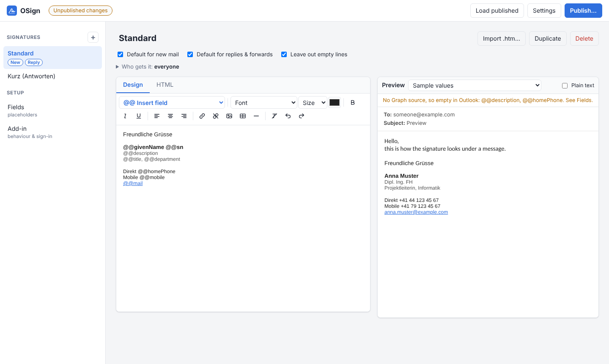

# NOBS OSign

Central email signatures for **classic and new Outlook**, managed in one place.

- **The editor** (`server/`, `editor/ui/`): a web application in a Docker container on the company's
  own server, behind its proxy. Admins sign in with their Windows account (an AD group) and design the
  signatures in German or English, set who gets which one, and publish them into SharePoint.
- **The Outlook add-in** (`addin/`): it inserts the right signature by itself in every new message,
  reply and forward, and switches signatures when the From address changes. Its pane lets users pick
  another signature or choose their own defaults. It fills the placeholders (`@@givenName`,
  `@@mobile`, and so on) with each user's details from Microsoft Graph. In Outlook it is called
  just **OSign** (its ribbon group, pane and notices).



**It runs without GitHub.** GitHub only holds the source code and the releases. The add-in's
files are made by the editor and served from a web server of the company's own choosing (Cloudflare
Pages, uploaded from the editor, or any HTTPS web server). The signatures, images and photos stay
in the company's own Microsoft 365: in a folder `OSign` in a SharePoint site. The add-in reads that
folder with each user's own sign-in, and embeds the images in the mail. Nothing on the server is
reachable from the internet.

```
 NOBS OSign (editor, Docker)         Company SharePoint (one site)        Outlook (every user)
 ┌──────────────────────────┐ write  ┌───────────────────────────┐ Graph  ┌───────────────────────────┐
 │ web UI, AD sign-in       │ ─────> │ OSign/signatures.json     │ ─────> │ NOBS OSign add-in         │
 │ publishes through Graph  │ (Sites │ OSign/assets/*.png        │ user's │  new mail / reply → sign  │
 │ (Sites.Selected)         │ .Sel.) │ OSign/photos/<user>.jpg   │ sign-in│  details, groups ← Graph  │
 └──────────────────────────┘        └───────────────────────────┘        │  images embedded (cid:)   │
              │ uploads the add-in's code (no data)                         └───────────────────────────┘
              └────────────> Cloudflare Pages (or any HTTPS web server) ──────────────┘
```

## Where it works

| Outlook | Automatic signature | Pane |
|---|---|---|
| New Outlook for Windows | yes | yes |
| Outlook on the web | yes | yes |
| Classic Outlook for Windows (Microsoft 365, current channel) | yes, from a copy (below) | yes |
| Outlook for Mac (new Outlook) | yes | yes |
| Outlook for iOS / Android (4.2352 and later) | preview, when switched on | - |

All of these need Exchange Online (Microsoft 365) mailboxes.

Classic Outlook refuses its event handler the sign-in (`untrusted_origin`), and shares with the pane
nothing but the add-in's settings in the mailbox, 32 KB in all. So the pane, opened once there,
keeps in them the signatures that go in by themselves, with their images made as small as they are
shown, as many as fit (the smallest first); the event handler takes them from there. An image that
does not fit (a large banner) is left out there, and the pane says so; *Insert* always puts in
everything. Until the pane was opened once, the notice says to open it.

The editor makes images smaller when they are uploaded or imported: at most 1200 pixels wide (twice
a wide signature, still sharp on high-resolution screens), photos at most 400; a JPEG saved again
at good quality, a PNG stays a PNG, a GIF as it is.

## Fields

These are the placeholders the signatures used before, mapped to where the add-in reads each value.

| Field | Placeholder | AD attribute | Microsoft Graph |
|---|---|---|---|
| Vorname | `@@givenName` | givenName | `givenName` |
| Name | `@@sn` | sn | `surname` |
| Beschreibung 1 | `@@description` | description | *(none, see below)* |
| Beschreibung 2 | `@@department` | department | `department` |
| Beschreibung 3 | `@@title` | title | `jobTitle` |
| Handy | `@@mobile` | mobile | `mobilePhone` |
| Direkte Nr. ext. | `@@homePhone` | homePhone | *(none, see below)* |
| Abwesenheit | `@@info` | info | *(none, see below)* |
| Mail | `@@mail` | mail | `mail` |

**Where the values come from** is a choice in the editor (*Add-in*): **Entra ID** (Microsoft Graph,
each field by its Graph source), **Active Directory** (the editor exports each user's fields into
`OSign/users/<mail>.json` on Publish and every day by itself), or
**both**: Graph where a field has a Graph source, AD for the rest.

Graph has no `description`, `homePhone` or `info`. To use them, sync them with Entra Connect,
either into `onPremisesExtensionAttributes.extensionAttribute1`…`15` or as directory extensions
(`extension_<appId>_description`). Then enter that path as the field's Graph source in the editor.
Until then those fields stay empty in Outlook. The editor's preview can still show them, because it
reads them from AD.

`@@sAMAccountName` (Benutzername, Graph `onPremisesSamAccountName`) is there as well. It also names
each person's photo: a template image `photos/@@sAMAccountName.jpg` becomes
`OSign/photos/<username>.jpg`, embedded in the mail; whoever has none gets the signature without.
The editor's **Photos** page lists them and adds one for a person: a file, or an image from a web
address (https on the internet only: the server refuses addresses in the company's network), made
400 pixels wide at most; *Insert image → Photo per person* puts the image into a signature, and the
preview says when the person shown has no photo. A placeholder photo (`photos/_default.jpg`: a
neutral one made with one click, or an image of your own) goes in for whoever has none, also for an
account with no login; without one, the signature goes without a photo.

A line whose fields all come out empty is left out, so nobody's signature shows "Mobile:" with no
number. This works for paragraphs, lines split by line breaks, and table rows.

## Getting started

Running it day to day (releasing in steps, backups, roles, what to look at when something is off):
[docs/ADMIN.md](docs/ADMIN.md).

Install the server ([docs/SETUP.md](docs/SETUP.md), "The editor on a server"), sign in as `admin`,
and the **setup assistant** walks through the rest:

1. **The server's connections:** Active Directory for the sign-in and the users' values, Cloudflare
   Pages for the add-in's files (Settings → Server: a part's button in the status list; *Save* checks them all again).
2. **SharePoint:** a folder `OSign` in a site everyone can read; paste its address (or a sharing
   link). Photos go into `OSign/photos` (`<username>.jpg`).
3. **Microsoft 365:** download the **setup script** and run it once on a Windows PC as SharePoint
   or Global administrator. It makes both app registrations (the add-in's and the server's), puts
   the server's own certificate on its app (no client secret), gives the server write access to
   that one site, sends the result to the server, and takes back the rights it used.
4. **The add-in's files:** made and uploaded to Cloudflare Pages from the assistant (or downloaded
   as a ZIP for another web server).
5. **Microsoft 365 admin center:** Settings → Integrated apps → Upload custom apps, with
   `https://<host of the add-in>/manifest.xml`, and assign it to the users.

## How a signature is chosen

Each signature can be the default for new mail, for replies and forwards, or both. It can also be
limited to **AD groups** (nested groups count), departments or sender domains. For each message:

1. If the editor allows user choice and the user picked a signature (or *none*) in the pane, that
   one is used.
2. Otherwise the default for that kind of message is used. When several defaults apply, the one for
   fewer people wins: sender domain before group before department before everyone.

**Campaigns** are banners for some days (the holidays, a fair, a webinar), put into the signatures
there are, so no signature is copied for them. Made under *Campaigns* without HTML (an image with a
link, a line of text with a button, an image beside a text, or HTML of your own), in other languages
too, for all signatures or some, below them or where a signature has `{{campaign}}`, for everyone or
some groups, and in new mail only if you like. Links can carry `utm_campaign` for the web
statistics. A timeline shows their days, *On a day* what each signature gets then, the status bar
(and the webhook) says when one ends with none after it, and *Copy for next year* makes the next one. Marketing can have a role of its own for the campaigns only;
the short guide for them is [docs/CAMPAIGNS.md](docs/CAMPAIGNS.md).

A signature can also be a campaign of its own: on its days only (say, December), and then it wins
over the usual default; before and after, the usual one comes back by itself.

Outlook's own signature is switched off for messages the add-in signs (an option in the editor), so
a mail never gets two.

**Users' own signatures.** In the pane (*OSign → Signatures*), a user can make a variant of a company
signature, kept in their mailbox and offered for new mail and replies:
- with the fields the editor marks *Editable in the add-in* only (a greeting, a line of their own):
  layout, images and every other field stay the company's, and follow its changes;
- or, when the editor allows *own signatures* (Add-in options), all of it, edited right in the pane:
  filled in with their details as they were then, the company's images kept, no images of their own,
  12 000 characters at most. Turned off again, those are not used (they come back when it is on).

## Importing existing templates

**+** next to *Signatures* → *Import templates* imports `.htm` templates with their images: from CI-Sign (it keeps them
next to `CI-Sign.exe`, as UTF-16, with images in `images\`) or from classic Outlook. Pick the
template files and images together. A per-person image (`images/@@sAMAccountName.jpg`) becomes the
photo from `OSign/photos`. CI-Sign's text blocks (`{##Name}…{end ##Name}` in
`__intern.htm`, picked with the templates) go into the templates that use them; one with days
(`{dats …}{date …}`) becomes a campaign of its own, one whose last day is past stays out. Picking
the whole CI-Sign share works: copies in `AutoBackup-…`, `editor`, `Templates` and
`ci-sign-update` are left unticked, and of images with the same name the current one is taken.
With a per-person photo in a template, the user photos in `images\` (named like a user,
`mustera.jpg`) can go into `photos\` of the OSign folder in the same step; they count at once.
Nothing else goes live before *Publish*. A report afterwards lists what came over and what is left
to do (images not picked, fields added, and *Who gets it*: CI-Sign's rules are not taken over).

## Who may do what

- **Editors** (members of the AD group set under *Settings → Server → Active Directory*, signed
  in with their AD account): make, change, import and publish signatures, edit fields, building
  blocks and the add-in's behaviour, look at users from AD, and approve someone else's publish when
  four eyes is on.
- With a **publishing group** set there, only its members publish (also at a set time), approve, write the users and change photos; the other editors ask for approval.
- **The local account `admin`** besides: the server connections, the setup script, the add-in's
  files (make, upload), backups, the audit log, four eyes, and the check where the add-in is
  deployed.

Fields read only contact details from AD (names, title, department, company, office, phone numbers,
mail, address, web page): what they read shows in the preview and is exported into SharePoint, where
every employee can read it. Only the local `admin` allows more attributes (*Settings → Server →
Active Directory*, `OSIGN_AD_ATTRIBUTES`); passwords and recovery keys never.

## Where the add-in is deployed

Microsoft offers no way for the server to ask this. *Settings → Server → Add-in in Microsoft 365 →
Check…* downloads a script that only reads (`Get-OrganizationAddIn`, signed in as a Global or
Exchange administrator) and sends what it found back with a one-time code: deployed or not, on or
off, its version, and who it is assigned to. The row shows that answer and when it came.

## Privacy

- GitHub holds only code; nothing at run time comes from it. The add-in's files on the company's
  web server are only code too, with the app registration ID filled in (it is not a secret).
- The server writes into one SharePoint site only (`Sites.Selected`), signed in with its own
  certificate; its key, passwords and tokens are kept encrypted in its data volume.
- Every sign-in, publish and change of the server's connections is in the audit log; publishing can
  need a second person's approval (four eyes); a backup is locked with a passphrase.
- Twice a day the server asks GitHub whether a newer release is out (`OSIGN_UPDATE_CHECK=0` stops
  that); nothing else leaves it except to Microsoft 365, the domain controller and Cloudflare.
- The signatures, images and photos are in the company's SharePoint, readable for its employees.
  The add-in reads them, and each user's details and groups, with that user's own sign-in
  (delegated permissions): it can never read more than the user can.
- Images go into the mail itself, so no recipient's mail program loads anything from anywhere.
- The add-in keeps a copy of the user's details in their own mailbox settings, read again after
  15 minutes and used when Graph cannot be reached; and the images in the browser's storage.

## Hosting the add-in elsewhere

Any HTTPS web server can serve the add-in's files; [docs/SETUP.md](docs/SETUP.md) step 3 lists
some. Moving them means: make the files again for the new address, add
`brk-multihub://<new host>` to the app registration, and upload the new `manifest.xml` in the admin
center. Without the editor, the build does the same:

```
npm ci
BASE_URL=https://intranet.example.com/osign/ OSIGN_CLIENT_ID=<app id> node addin/build.mjs
```

and serve `dist/site/`. `OSIGN_SP_SITE` and `OSIGN_SP_FOLDER` choose another SharePoint site or
folder for the signatures.

The web UI talks to its backend only through the HTTP API in [docs/API.md](docs/API.md).
[docs/ARCHITECTURE.md](docs/ARCHITECTURE.md) describes the parts.

## Development

```
npm ci
npx playwright install chromium   # once, for the browser tests
npm test                          # builds dist/template, then runs every test
```

With a Chromium installed elsewhere (not the one Playwright downloads), point the browser tests at
it: `OSIGN_TEST_CHROMIUM=/path/to/chrome npm test`.

The setup script's test needs `pwsh` (PowerShell 7) and is skipped without it; CI also runs it under
Windows PowerShell 5.1.

| Path | What |
|---|---|
| `shared/signature-core.js` | Placeholders, empty lines, who gets which signature. The editor's preview and the add-in both run this one file. |
| `editor/ui/` | The editor's web UI; its script in parts by topic (`editor/ui/app/01-base.js` … `11-start.js`), which the server serves as one `/ui/app.js` |
| `server/` | The editor's backend: sign-in, draft, publishing through Graph, AD, the add-in's files, the setup script (Docker: `Dockerfile`, `docker-compose.yml`, `deploy-nobs-osign.sh`) |
| `addin/` | The Outlook add-in: event handler, pane, manifest template, build (`build.mjs`, `fill.mjs`) |
| `tests/` | Engine, add-in runtime, server API (with stand-ins for AD, SharePoint, Microsoft and Cloudflare), the setup script, editor and pane in a browser |

## Known limits

- **Classic Outlook (Windows)** puts signatures in by itself from a copy the pane keeps in the
  mailbox, when Outlook refuses the add-in the sign-in there: about 30 KB for all of it (Microsoft's
  limit for an add-in's settings). What does not fit is made smaller for that copy, step by step;
  what still does not fit is left out there (the largest image first). *Insert* in the pane puts
  in everything. The editor says how much a signature takes, and what happens to it there.
- **Rounded corners** and a round photo do not show in classic Outlook for Windows (Word draws the
  mail); there the image stays square.
- **Dark mode** is Outlook's own: the preview shows it roughly. A dark logo on a transparent
  background is hard to see there (the publish check says so).
- **Browsers**: tested in Chromium (Edge, Chrome). Firefox and Safari should work; dragging in the
  design uses another method there and has not been tried.
- **A signature limited to AD groups** needs the groups synced to Entra ID (with values from Graph)
  or the users written from AD (Users).
- **Photos per person** are files in the `photos` folder, by name; Entra ID's own profile photos are
  not read.

What changed from version to version: [CHANGELOG.md](CHANGELOG.md).

## Releases

Each version is a tag (`v0.9.0`) with the server's install files `nobs-osign-server-0.9.0.tar.gz`
and their checksums on the GitHub releases page, and the Docker image
`ghcr.io/monsama/nobs-osign:0.9.0`, scanned before it is pushed. The install files name the image
by its digest, so an install runs exactly the image that was scanned; both carry a build
attestation, which `scripts/update.sh` checks where the GitHub CLI is there (`gh attestation verify
<file> --repo monsama/nobs-osign`). The version is kept in `package.json`, `package-lock.json` and
`docker-compose.yml`; the add-in's manifest takes it from `package.json`.

To release, raise the version on main (`node scripts/bump-version.mjs 0.9.0`), then either push
the tag with `scripts/release.sh 0.9.0`, or run the **release** workflow by hand on main (Actions →
release → Run workflow): it tags the version in `package.json` and publishes it. The tests have to
pass first, and a version that is already tagged is refused.

## License

GPL-3.0-or-later, see [LICENSE](LICENSE).
